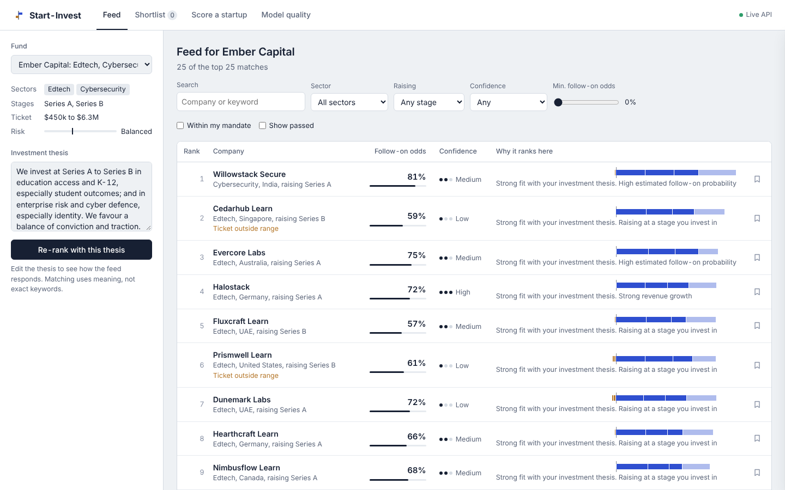
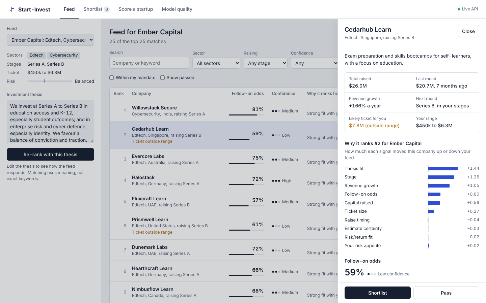
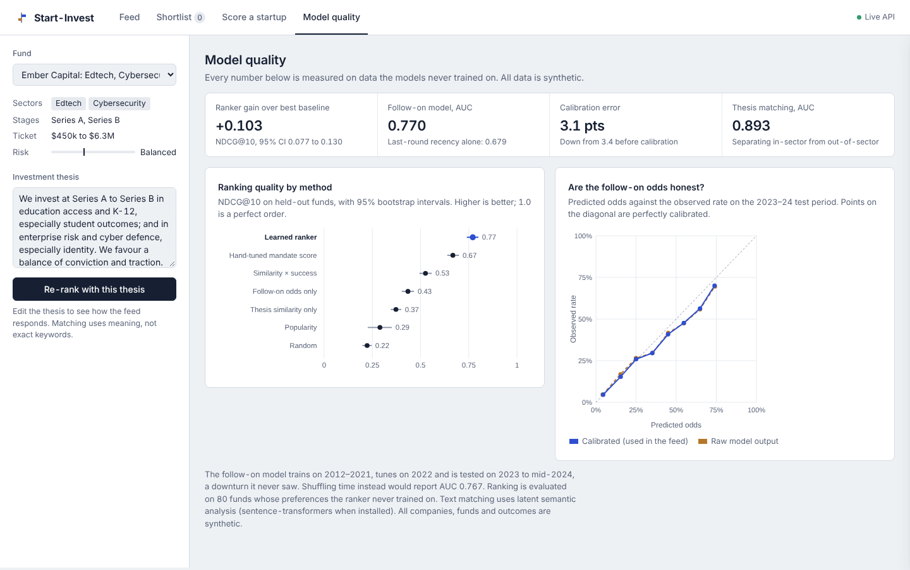
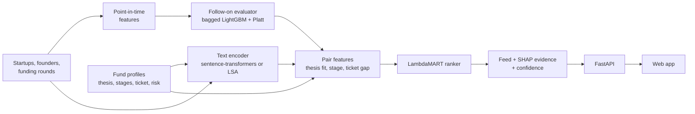

# Start-Invest

[](https://github.com/RebekahZx/Start-Invest/actions/workflows/ci.yml)

A deal-flow desk for venture funds. Each fund gets a ranked feed of startups, scored on fit with its thesis and mandate and on how likely each company is to raise again, with every ranking explained.

Originally built at the Consensus Hong Kong 2026 hackathon (finalist). This repository is a 2026 rebuild with a proper evaluation harness, an API, a web app and tests.

> **All data is synthetic.** A seeded generator produces startups, founders, funding rounds and funds with realistic structure, including a 2021 boom and a 2023 downturn. The results below measure the pipeline against that generator. They are not claims about real markets. See the [model card](docs/MODEL_CARD.md).



## What it does

- **Ranked feed per fund.** A learned ranker weighs thesis fit, stage and ticket-size fit, and follow-on odds, differently for cautious and aggressive funds.
- **Evidence on every row.** A diverging strip shows what pushed each company up or down. The detail view breaks this into every signal, plus the reasoning behind the follow-on estimate.
- **Live re-ranking.** Edit a fund's thesis and the feed re-ranks on meaning, not keywords.
- **Analyst workflow.** Filters (sector, stage, confidence, minimum odds, within mandate), a shortlist with CSV export, and pass/undo.
- **Score any startup.** Enter what you know and get calibrated odds. Unknown fields are excluded from the explanation.
- **Model quality view.** Ranking quality against six baselines with confidence intervals, plus a reliability diagram for the odds.

| Detail view | Model quality |
|---|---|
|  |  |

## Architecture



| Component | Approach |
|---|---|
| Follow-on evaluator | Five bagged LightGBM classifiers, time-based validation (train before 2022, calibrate on 2022, test on 2023–24), Platt calibration; ensemble disagreement as confidence |
| Leakage control | Features use only events on or before the prediction date, enforced by a test that alters future rounds and checks nothing changes |
| Thesis matching | `all-MiniLM-L6-v2` when available, TF-IDF + SVD fallback with no network needed |
| Ranker | LightGBM LambdaMART, trained and evaluated on disjoint funds |
| Explanations | SHAP on both models, turned into plain-language reasons that never cite missing inputs or contradict the facts |

## Results

Default run (`make train`): 6,000 startups, 400 funds, seed 7.

**Ranking, NDCG@10 on 80 held-out funds (95% bootstrap CI)**

| Method | NDCG@10 |
|---|---|
| **LambdaMART ranker** | **0.771** [0.740, 0.800] |
| Hand-tuned mandate score (similarity + odds + stage + ticket) | 0.668 [0.638, 0.699] |
| Similarity × odds | 0.526 [0.494, 0.558] |
| Follow-on odds only | 0.435 [0.402, 0.466] |
| Thesis similarity only | 0.372 [0.345, 0.400] |
| Popularity (total raised) | 0.289 [0.226, 0.351] |
| Random | 0.223 [0.199, 0.246] |

Ranker minus the strongest baseline: **+0.103** [+0.077, +0.130], paired bootstrap over funds.

**Follow-on evaluator, 2023–24 test period** (n = 2,255): AUC 0.770 against 0.679 for last-round recency alone, Brier 0.170, calibration error 3.1 points. Thesis similarity separates in-sector from out-of-sector pairs with AUC 0.893.

## Quick start

```bash
make install    # pip install -e ".[dev]"   (add ,embeddings for sentence-transformers)
make train      # trains everything, prints the tables above, writes artifacts/
make serve      # API + web app at http://localhost:8000, API docs at /docs
make test       # 20 unit and API tests, about 5 s
```

Or with Docker (trains at build time, deterministic):

```bash
make docker && make docker-run    # http://localhost:8000
```

### Static demo

`make demo` exports a snapshot of 30 funds to `web/demo-data.json`. Opened without an API, the web app runs from that snapshot, and the `pages` workflow publishes it to GitHub Pages. To enable that, go to **Settings → Pages → Source: GitHub Actions**.

## API

| Method | Endpoint | Description |
|---|---|---|
| GET | `/investors` | Fund profiles, held-out funds first |
| GET | `/investors/{id}/feed?k=10` | Ranked feed: odds, confidence, mandate facts, reasons, full SHAP contributions |
| POST | `/investors/{id}/feed` | Same, with an optional `thesis` to re-rank live |
| POST | `/score` | Score by `startup_id` or an ad-hoc `features` dict; lists missing fields |
| GET | `/metrics` | Full evaluation results, including reliability bins |
| GET | `/health` | Status, version, embedding backend |

Every response carries `x-request-id` and `server-timing` headers. Set `START_INVEST_CORS_ORIGINS` to allow browser clients on other origins.

## Engineering

- **CI** (GitHub Actions): ruff lint and format; tests on Python 3.10, 3.11 and 3.12; Playwright browser tests; Docker build plus a container smoke test.
- **Tests:**
  - Leakage, label definition and time-split integrity.
  - Metric correctness against known values.
  - The ranker beats every baseline with a CI above zero.
  - Calibration bounds.
  - API contract and error codes.
  - Thesis override actually shifts sectors.
  - Browser tests for the feed, detail view, shortlist export, filters and scoring.
- **Configuration:** `START_INVEST_BUNDLE`, `START_INVEST_WEB` and `START_INVEST_CORS_ORIGINS` environment variables.
- **Container:** multi-stage, non-root user, healthcheck.

## Layout

```
src/start_invest/
  data.py         synthetic generator
  features.py     point-in-time features, time split
  evaluator.py    bagged, calibrated LightGBM + SHAP
  embeddings.py   sentence-transformers / LSA encoder
  ranker.py       candidates, pair features, LambdaMART
  explain.py      SHAP -> labelled contributions and reasons
  metrics.py      NDCG, calibration, bootstrap CIs
  pipeline.py     training and evaluation
  service.py      inference
  api.py          FastAPI app
  export_demo.py  static snapshot for GitHub Pages
web/index.html    web app (no build step)
tests/            unit, API and e2e (Playwright) tests
docs/             model card, screenshots
```

## License

MIT
