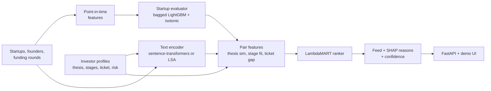

# Startup Match

A personalised startup-investment feed. For each investor, it ranks startups by how well they fit the investor's thesis, stage and ticket size, weighs that against an estimate of each startup's chance of raising its next round, and explains every recommendation.

Originally built at the Consensus Hong Kong 2026 hackathon (finalist). This repository is a rebuild with a proper evaluation harness, an API, tests and a demo UI.

> **All data here is synthetic.** It comes from a generator in which each startup has a hidden quality that drives funding, traction and founder strength through noisy observables, plus a year-by-year funding climate (the 2021 boom, the 2023 downturn). The numbers below measure the pipeline against that generator. They are not claims about real markets.

## Architecture



| Component | What it does |
|---|---|
| **Startup evaluator** | Estimates P(the startup raises another round within 24 months). Five bagged LightGBM models early-stopped on a later time window, then isotonic-calibrated. The spread across the ensemble is reported as a confidence estimate. |
| **Point-in-time features** | Funding progression, round cadence, founder experience and exits, traction, hiring and usage growth, sector, country. Only events dated on or before the prediction date are used. This is enforced by a test. |
| **Time-based validation** | Train on snapshots before 2022, validate on 2022, test on 2023 to mid-2024, so the model is always scored on a period it never saw, including a funding-climate shift. |
| **Text matching** | Founder bios, startup descriptions and investor theses are embedded, and cosine similarity measures thesis fit. Uses `all-MiniLM-L6-v2` when `sentence-transformers` is installed, otherwise TF-IDF + SVD (no network needed). |
| **Learning to rank** | LambdaMART (LightGBM `lambdarank`) learns how each investor profile trades off thesis fit, mandate fit, success probability and uncertainty, instead of multiplying two scores. Trained and evaluated on disjoint investors. |
| **Explanations** | SHAP values on both models become short reasons, such as "Strong fit with your investment thesis" or "Weak revenue-growth evidence". Inputs that were missing are never shown as reasons. |

## Results

`startup-match-train` with defaults (6,000 startups, 400 investors, seed 7, LSA embeddings):

**Startup evaluator** (time-split test set, n = 2,200, base rate 29%)

| Metric | Value |
|---|---|
| ROC AUC | 0.761 |
| Brier score | 0.172 |
| Expected calibration error | 0.026 → 0.023 after isotonic calibration |
| Baseline: recency of last round alone | AUC 0.681 |
| Random split (ignores time, for comparison) | AUC 0.769 |

**Ranking** (NDCG@10 on 80 held-out investors, 95% bootstrap CI)

| Method | NDCG@10 |
|---|---|
| **LambdaMART ranker** | **0.775** [0.748, 0.800] |
| Hand-tuned mandate score (similarity + success + stage + ticket) | 0.633 [0.603, 0.666] |
| Similarity × success (naive product) | 0.527 [0.495, 0.559] |
| Success probability only | 0.429 [0.399, 0.461] |
| Text similarity only | 0.382 [0.352, 0.410] |
| Popularity (total raised) | 0.343 [0.299, 0.390] |
| Random | 0.219 [0.195, 0.244] |

Paired bootstrap, ranker minus the strongest baseline: **+0.141 NDCG@10** [+0.112, +0.172].

Text embeddings separate in-sector from out-of-sector investor–startup pairs with AUC 0.931.

## Quick start

```bash
pip install -e ".[dev]"            # add ",embeddings" for sentence-transformers
startup-match-train                # trains everything, writes artifacts/, prints the tables above
uvicorn startup_match.api:app --reload
# open http://localhost:8000
pytest                             # 20 tests, ~5 s
```

## API

| Method | Endpoint | Description |
|---|---|---|
| GET | `/investors` | Investor profiles |
| GET | `/investors/{id}/feed?k=10` | Ranked feed with scores, P(success), confidence and reasons |
| POST | `/investors/{id}/feed` | Same, with an optional `thesis` to re-personalise the feed live |
| POST | `/score` | Score a startup by `startup_id` or an ad-hoc `features` dict (lists missing fields) |
| GET | `/metrics` | Full evaluation results |
| GET | `/health` | Status and active embedding backend |

Interactive docs are at `/docs`.

## Tests

- **Leakage:** removing, or inflating, every round dated after the snapshot leaves all features unchanged.
- **Labels:** each label matches the 24-month definition, checked directly against the round history.
- **Splits:** train, validation and test are time-ordered and share no startups.
- **Metrics:** NDCG and calibration error are checked against known values.
- **Models:** the ranker beats every baseline with a CI above zero, and the evaluator is calibrated.
- **API:** feed contract, thesis override that actually shifts sectors, missing-feature handling, error codes.

## Layout

```
src/startup_match/
  data.py        synthetic generator (startups, founders, rounds, investors)
  features.py    point-in-time features and time split
  evaluator.py   bagged, calibrated LightGBM + SHAP
  embeddings.py  sentence-transformers / LSA encoder
  ranker.py      candidates, pair features, LambdaMART
  explain.py     SHAP -> human-readable reasons
  metrics.py     NDCG, calibration, bootstrap CIs
  pipeline.py    end-to-end training and evaluation
  service.py     inference service
  api.py         FastAPI app
web/index.html   demo UI
tests/           pytest suite
```

## Limitations

- Synthetic data: the ranking ground truth is produced by the same generator, so results show the method works on structure like this, not that it would match real investor behaviour.
- The candidate pool is a fixed held-out set, and there is no online learning from investor feedback yet.
- Confidence comes from ensemble disagreement, which captures model uncertainty but not data shift.

## License

MIT
